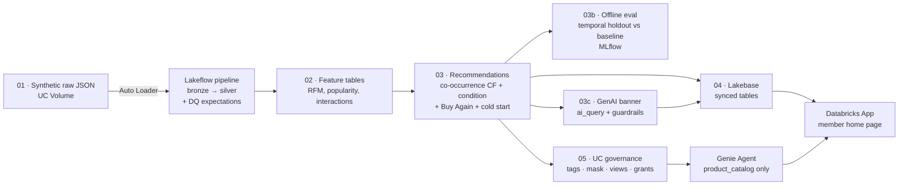

# SilverLeaf Benefits — Personalized OTC Benefits Store

**Industry:** Healthcare / Medicare Advantage supplemental benefits
**Customer problem:** A supplemental-benefits administrator runs an online OTC (over-the-counter)
store where Medicare Advantage members spend a monthly allowance (typically $25–$150) on health
products. Every member sees the **same best-seller home page**, so a diabetic member on a $50
allowance scrolls past walkers and hearing-aid batteries to find test strips — or doesn't, and
**leaves the allowance unspent**. Unspent allowance means members are missing benefits they're
entitled to, and it weakens the health plan's case to the members (and in Star-rating surveys)
that the benefit is worth having.

**What this builds:** an end-to-end, all-Databricks personalization engine. Every member gets a
home page ordered for *their* health conditions, purchase history, and allowance, plus a GenAI
welcome banner and a natural-language product finder — refreshed nightly, served in milliseconds.

> All data is **synthetic** (seeded generator, `src/01_generate_data.py`). "SilverLeaf Benefits"
> is fictional. No real members, no PHI.

**Execution evidence (text, captured live from the workspace):** [`evidence/EVIDENCE.md`](evidence/EVIDENCE.md)

---

## The integrated data journey



Text version of the same flow:

```
raw JSON (Volume) ─Auto Loader─> bronze_* ─expectations─> silver  (Lakeflow, src/ingest_pipeline/)
   └─> member_features / product_popularity / interactions              (02)
        └─> recommendations + category_recommendations                  (03, MLflow)
             ├─> recommendation_offline_eval                            (03b, MLflow)
             ├─> member_messages  (ai_query → guardrails → fallback)    (03c, MLflow)
             ├─> Lakebase synced tables  ─────────────┐                 (04)
             └─> tags · column mask · analyst view ·  │                 (05)
                 product_catalog view → Genie Agent ──┤
                                                      └─> Databricks App (app/)
```

One Lakeflow Job (`databricks.yml`) runs the whole DAG; every stage reads the previous stage's
Unity Catalog tables — nothing is copied by hand between stages.

| Stage | Where | What it does |
|---|---|---|
| **Lakeflow** — ingest | `src/01_generate_data.py`, `src/ingest_pipeline/*.sql` | Lands 5 raw JSON feeds in a UC Volume; a serverless Lakeflow Declarative Pipeline ingests them with Auto Loader into bronze, then types and validates them into silver with `EXPECT` data-quality rules |
| **Unity Catalog** — govern | `src/05_governance_and_genie.py` | Classification tags on tables and sensitive columns, a `mask_health_conditions` column-mask function, a de-identified `members_analyst_v`, a shopper-safe `product_catalog` view, least-privilege grants for the app's service principal, lineage via system tables |
| **ML** — intelligence | `src/02_feature_engineering.py`, `src/03_train_and_score.py`, `src/03b_evaluate_recommendations.py` | RFM features; item-to-item co-occurrence collaborative filtering (optional ALS); condition-matched, Buy-Again and cold-start shelves; **temporal-holdout evaluation** of every recommender against today's best-seller page (HitRate / Precision / Recall / NDCG @10) logged to MLflow |
| **GenAI** — intelligence | `src/03c_genai_member_messages.py` | `ai_query()` writes a one-sentence welcome banner per member in batch; **five guardrail checks** (no medical claims, no condition named on screen, no invented prices or products, length) — any failure falls back to a safe template; pass rate logged to MLflow |
| **Lakebase** — serve | `src/04_sync_to_lakebase.py` | Managed synced tables (Snapshot reverse ETL) copy the serving tables into Lakebase Autoscaling Postgres; the app's SP gets `SELECT` only |
| **Genie Agent** — ask | `genie/product_catalog_space.json`, notebook 05 | "SilverLeaf Product Finder", created/updated from versioned config; scoped to `product_catalog` only, so it can find products but cannot reach member, order or spend data |
| **Databricks App** — surface | `app/app.py` | Streamlit member portal: GenAI banner, personalized category carousel, three product shelves from Lakebase, and "Ask SilverLeaf" powered by the Genie Agent |

---

## What the member sees

| Section | Source | How it's built |
|---|---|---|
| ✨ **Welcome banner** | `member_messages` → Lakebase | Foundation model via `ai_query()`, guardrail-checked |
| 🛍️ **Shop Your Categories** | `category_recommendations` → Lakebase | Categories ranked by the member's purchases + health-condition relevance |
| ✨ **Recommended for You** | `recommendations` → Lakebase | "Members who bought what you bought also bought…"; best-sellers for brand-new members |
| 🔁 **Buy It Again** | `recommendations` → Lakebase | Consumables the member has reordered 2+ times |
| 🩺 **Picked for Your Health** | `recommendations` → Lakebase | Best-sellers tagged for the member's conditions that they don't own yet |
| 🔎 **Ask SilverLeaf** | Genie Agent | Natural-language product search ("something for joint pain under $15") |

Nothing is computed at request time. A page load is three primary-key lookups in Lakebase.

---

## How we know the recommendations are better (notebook 03b)

The question a VP of Member Experience asks is *"is this better than what we show today?"* —
so the baseline is today's page: the same best-sellers for everyone.

1. Hold out the last 60 days of purchases.
2. Rebuild every recommender from purchases **before** the cutoff only.
3. Score each one on the products members went on to buy **for the first time** after the cutoff.

Results — HitRate@10 and NDCG@10 lift over the baseline — are in
[`evidence/04_ml_genai.md`](evidence/04_ml_genai.md), in the `recommendation_offline_eval` table,
and in the MLflow run `home_page_recs_offline_eval`.

---

## Governance model

| Who | Sees | How it's enforced |
|---|---|---|
| Member (via the app) | Their own page only | App looks up by `member_id` in Lakebase; the app SP has `SELECT` on the three serving tables and nothing else |
| Shopper questions (Genie) | Product attributes + popularity | Genie Agent's only data source is the `product_catalog` view |
| Business analysts | Members de-identified | `members_analyst_v`: no names, age banded, conditions masked by `mask_health_conditions()` |
| Care team | Health conditions | Membership in the `silverleaf-care-team` account group unlocks the mask |

Every table and sensitive column carries namespaced classification tags (`silverleaf_layer`,
`_domain`, `_contains`, `_sensitivity`, `_data_origin=synthetic`), so they show up in Catalog
Explorer search and can drive tag-based policies. (Namespaced because in a shared metastore, bare
keys like `layer` are often governed tags owned by another team.)

---

## Repo layout

| Path | Purpose |
|---|---|
| `databricks.yml` | Declarative Automation Bundle: Lakeflow pipeline, the end-to-end Job, the App |
| `src/01_generate_data.py` | Seeded synthetic raw data → JSON files in a UC Volume |
| `src/ingest_pipeline/` | Lakeflow Declarative Pipeline SQL: `bronze.sql` (Auto Loader), `silver.sql` (types + expectations) |
| `src/02_feature_engineering.py` | RFM, popularity, member–product interactions; documents the input contract |
| `src/03_train_and_score.py` | Recommendation shelves + category ranking (MLflow) |
| `src/03b_evaluate_recommendations.py` | Temporal-holdout offline evaluation vs best-seller baseline (MLflow) |
| `src/03c_genai_member_messages.py` | `ai_query()` welcome banner + guardrails + fallback (MLflow) |
| `src/04_sync_to_lakebase.py` | Lakebase synced tables + Postgres grants for the app SP |
| `src/05_governance_and_genie.py` | Tags, column mask, analyst view, `product_catalog`, grants, Genie Agent |
| `genie/product_catalog_space.json` | Versioned Genie Agent definition (instructions, example SQL, sample questions) |
| `app/` | Streamlit Databricks App |
| `scripts/capture_evidence.py` | Pulls live text evidence for every stage into `evidence/` |
| `evidence/` | Committed execution evidence |
| `deck/` | Business-audience presentation |
| `TALK_TRACK.md` | Demo script for business and technical stakeholders |

---

## Deploy and run

**Prerequisites:** a workspace with serverless compute, Unity Catalog, Lakebase Autoscaling, a SQL
warehouse, and a Foundation Model endpoint (default `databricks-claude-sonnet-4-6`).

```bash
# 1. Catalog + Lakebase project (one time)
databricks catalogs create silverleaf --profile <p>
databricks postgres create-project member-personalization --profile <p>

# 2. Workspace-specific values in a git-ignored databricks.local.yml
cat > databricks.local.yml <<'EOF'
targets:
  dev:
    workspace:
      host: https://<your-workspace>.cloud.databricks.com
    variables:
      catalog: silverleaf
      lakebase_endpoint: projects/member-personalization/branches/production/endpoints/primary
      lakebase_branch: projects/member-personalization/branches/production
EOF

# 3. Deploy (creates the pipeline, job and app), start the app, run the DAG
databricks bundle deploy -t dev --profile <p>
databricks bundle run home_page -t dev --profile <p>
databricks bundle run personalization_pipeline -t dev --profile <p>

# 4. Capture text evidence
uv run --with databricks-sdk --with "psycopg[binary]" \
  scripts/capture_evidence.py --profile <p> --catalog silverleaf
```

The job's ingest task runs the pipeline with `full_refresh: true`, because notebook 01 rewrites
the raw files each run (see `docs/lakeflow-ingestion.md`). With real incremental feeds, drop the
flag and Auto Loader picks up only new files.

### Configuration (bundle variables)

| Variable | Default | Controls |
|---|---|---|
| `catalog` / `schema` | `main` / `personalization` | Where everything is written |
| `generate_synthetic_data` | `"true"` | `"false"` = bring your own silver tables via `src_*` |
| `cf_method` | `cooccurrence` | `als` for a trained matrix-factorization model (classic compute) |
| `holdout_days` | `60` | Offline evaluation window |
| `llm_endpoint` | `databricks-claude-sonnet-4-6` | Model `ai_query()` uses for the banner |
| `care_team_group` | `silverleaf-care-team` | Group that can see unmasked health conditions |
| `mlflow_experiment` | `/Shared/silverleaf-personalization` | Where scoring, eval and GenAI runs are logged |
| `schedule_*` | daily 6am ET, paused | Nightly refresh cadence |

### Bring your own data

Set `generate_synthetic_data=false`, drop the `generate_data` and `ingest_raw` tasks, and point
the `src_*` variables at your tables. The input contract is documented at the top of
`src/02_feature_engineering.py`.

---

## Production notes

- **PHI:** member health conditions are PHI in a real deployment. They never leave Unity Catalog
  except as the member's own page in Lakebase, are masked for analysts, and are never sent to the
  Genie Agent. The GenAI prompt deliberately excludes conditions and a guardrail rejects any
  banner that names one.
- **Scale:** the pipeline recomputes everything nightly, which is fine at POC scale. At full
  membership, move product popularity to a weekly cadence and recompute only members with new
  orders (`MERGE` on `member_id`).
- **Online learning loop:** next step is writing add-to-cart clicks back to Lakebase and syncing
  them to Delta, so the evaluation in 03b can run on real outcomes instead of a holdout.
